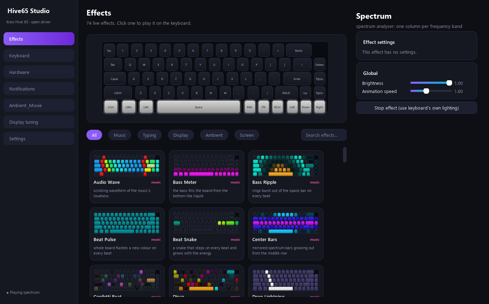
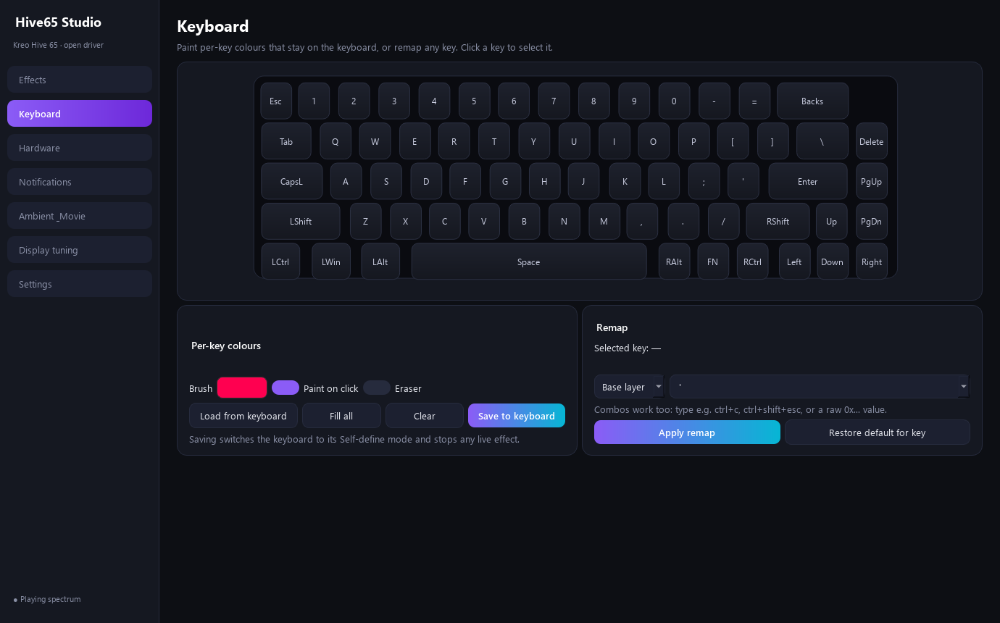
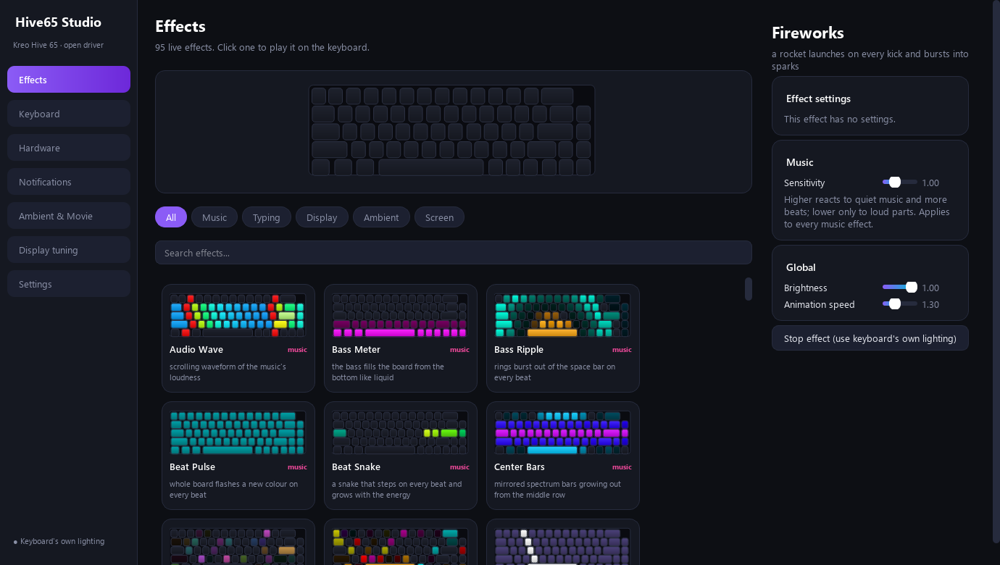
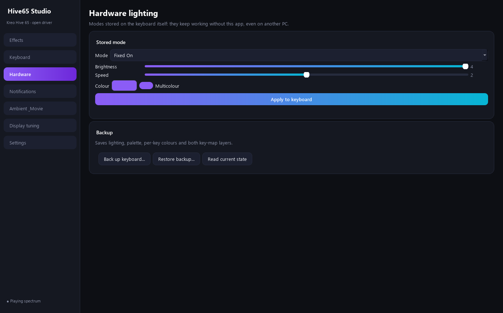
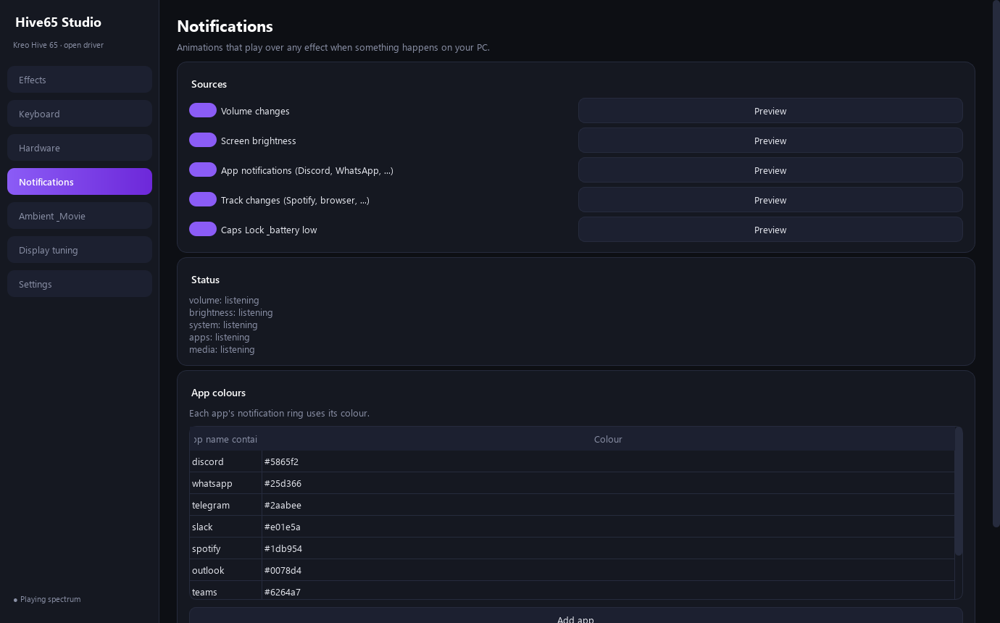
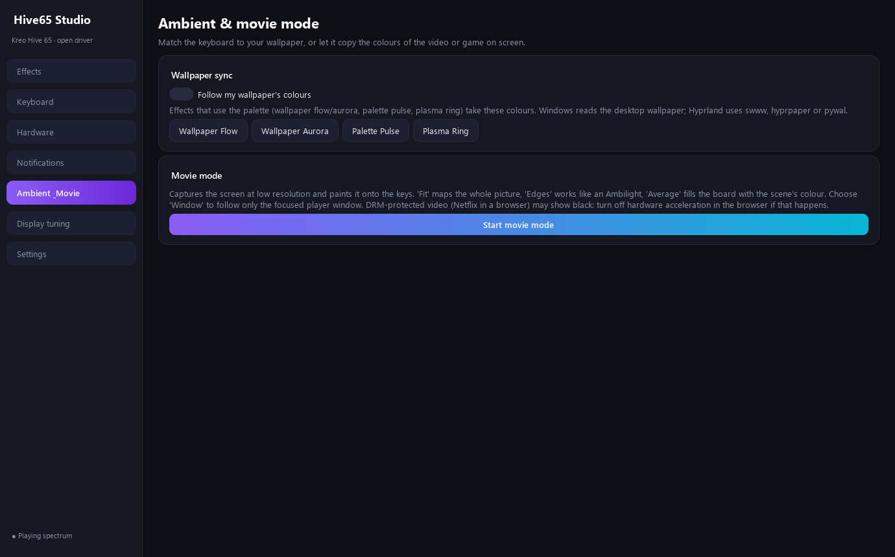
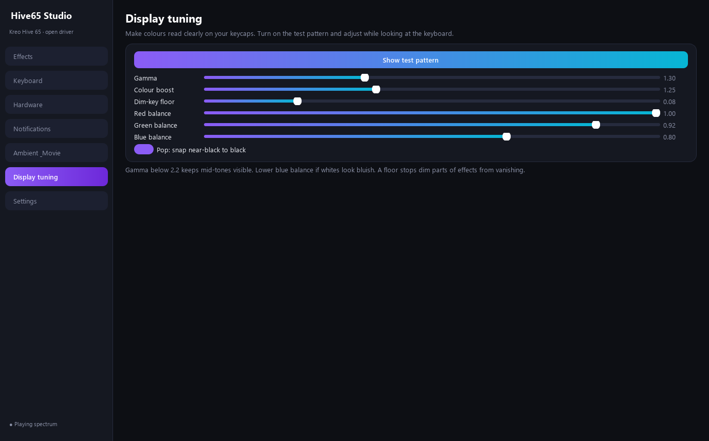
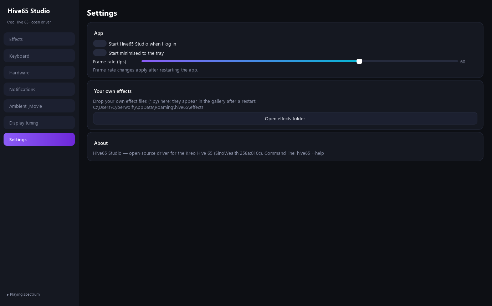
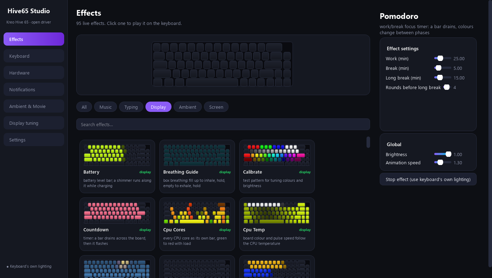

# Hive65 Studio ⌨️✨
> **Open-Source Driver, Studio App, Procedural Effects & Lighting Engine for the Kreo Hive 65 Mechanical Keyboard**

<div align="center">

[](https://python.org)
[](https://doc.qt.io/qtforpython/)
[](https://archlinux.org)
[](https://microsoft.com/windows)
[](https://github.com/Bharatsingh7/hive65-studio/releases)
[](LICENSE)

**A high-performance, reverse-engineered open-source replacement for the proprietary Kreo Hive 65 software. Native on Linux (Arch / Hyprland / Wayland) and Windows.**

[✨ Features](#-key-features) • [🖼️ Screenshots](#-screenshots--walkthrough) • [🚀 Download & Quickstart](#-download--quickstart) • [⚡ Effects](#-effects-ecosystem-107-built-in) • [🛠️ CLI & Automation](#-command-line-interface) • [🔌 Protocol](#-reverse-engineered-protocol)

</div>

---

<div align="center">
  
  <p><em>Home Dashboard: Real-time visual keyboard canvas, ambient tint, scene presets, and quick toggles.</em></p>
</div>

---

## ✨ Key Features

* 🎛️ **107 Built-in Live Effects**: Spanning music spectrums, typing waves, procedural physics, system telemetry, and classic gaming automata.
* 🎵 **Beat-Synchronized Audio Engine**: Low-latency audio spectrum analyzer supporting frequency bars, drum hit rows, energy surges, and customizable sensitivity sliders.
* 🧪 **Two-Effect Layer Mixer**: Blend any two effects simultaneously on your board with blend modes (`Screen`, `Add`, `Multiply`, `Max`, `Mix`) and opacity tuning.
* 🤖 **Smart Scene Automations**: Dynamically switch lighting profiles based on focused application (e.g. Spotify, VS Code, Steam games), fullscreen status, system idle timeouts, or time of day.
* 🎨 **Per-Key RGB Painter & Remapping**: Color individual key switches, highlight WASD or shortcut clusters, and rebind any key on the base or FN layers.
* 🎬 **Screen Movie Mode & Wallpaper Sync**: Real-time ambient edge sampling via Wayland `grim` / DXGI Desktop Duplication, plus color palette extraction from your active desktop wallpaper.
* 📊 **Hardware Telemetry Displays**: Monitor CPU core loads, CPU temperatures, RAM usage, GPU load, network traffic, internet ping, and battery level directly across the keys.
* 🔔 **Interactive System Overlays**: Non-intrusive notification overlays for volume adjustments, brightness sliders, media track changes, and desktop app notifications.
* 🐧 **First-Class Linux & Windows Support**: Runs flawlessly on Linux (Hyprland / Sway / Wayland / X11 via direct `hidraw` with zero root requirement) and Windows 10/11.

---

## 🖼️ Screenshots & Walkthrough

<div align="center">
  <h3>✨ Effects Gallery & Audio Reactivity</h3>
  
  
  <p><em>Browse 107 categorized effects with instant hover preview, and fine-tune beat detection sensitivity.</em></p>
</div>

<div align="center">
  <h3>🧪 Dual-Layer Mixer & Smart Automations</h3>
  
  
  <p><em>Combine multiple visualizers with blend modes and set automatic profile switches for games or quiet hours.</em></p>
</div>

<div align="center">
  <h3>🎨 No-Code Effect Builder & Per-Key Customizer</h3>
  
  
  <p><em>Design custom lighting animations with live preview, and paint custom per-key color maps.</em></p>
</div>

<div align="center">
  <h3>⚙️ Hardware Modes & Display Calibration</h3>
  
  
  <p><em>Backup/restore keyboard onboard memory and tune gamma, white balance, and color saturation.</em></p>
</div>

---

## 🚀 Download & Quickstart

### 🐧 Linux (Arch / Hyprland / Any Distro)

#### Option 1: Standalone Linux AppImage (Instant Run)

Download the prebuilt AppImage from [GitHub Releases](https://github.com/Bharatsingh7/hive65-studio/releases):

```bash
chmod +x Hive65-Studio-0.3.0-x86_64.AppImage

# 1. Install udev rule once (grants non-root USB keyboard access)
./Hive65-Studio-0.3.0-x86_64.AppImage --install-udev

# 2. Add application to desktop launcher
./Hive65-Studio-0.3.0-x86_64.AppImage --install-desktop

# 3. Launch Studio
./Hive65-Studio-0.3.0-x86_64.AppImage
```

To start minimized at login on **Hyprland**, add to `hyprland.conf`:
```ini
exec-once = /path/to/Hive65-Studio-0.3.0-x86_64.AppImage --minimized
```

#### Option 2: Automated Installer

```bash
git clone https://github.com/Bharatsingh7/hive65-studio.git
cd hive65-studio
sh packaging/linux/install.sh
```

---

### 🪟 Windows (10 / 11)

#### Option 1: Portable Executable (No installation required)
Download `Hive65-Studio-0.3.0-Portable.exe` from [Releases](https://github.com/Bharatsingh7/hive65-studio/releases) and double-click to run.

#### Option 2: PowerShell Installer
```powershell
powershell -ExecutionPolicy Bypass -File packaging\windows\install.ps1
```

---

## ⚡ Effects Ecosystem (107 Built-in)

List all available effects anytime via `hive65 effects`:

* **Music & FFT Audio (26)**: `spectrum`, `center_bars`, `gravcenter`, `horizon_eq`, `spectrogram`, `vu`, `bass_meter`, `drum_rows`, `pulse_rings`, `disco`, `fireworks`, `strobe_chase`, `swirl`, `rain_drops`, `audio_wave`...
* **Procedural Physics & Fluid (12)**: `fluid` (smoke stirred by keyboard strokes), `rain_window`, `cyber_trail`, `glitch`, `warp_speed`, `audio_terrain`, `lava_flow`, `northern_storm`, `nebula`...
* **Typing Reactive (13)**: `typing_fire`, `lightning` (arcs across active keys), `splash` (liquid ripples), `wpm_meter`, `combo`, `heatmap`, `shockwave`, `crosshair`...
* **Generative & Automata (29)**: `aurora`, `starfield`, `lava_lamp`, `fireflies`, `matrix_rain`, `tetris`, `snake`, `game_of_life`, `hypno`, `plasma`...
* **System Telemetry & Wellbeing (24)**: `cpu_cores`, `cpu_temp`, `ram_fill`, `gpu_meter`, `net_traffic`, `ping_meter`, `pomodoro`, `box_breathing`, `sunrise_alarm`...

---

## 🛠️ Command-Line Interface

When Hive65 Studio is running in the background, the `hive65` CLI sends instant IPC commands:

```bash
# General controls
hive65 next                      # Next favorite effect
hive65 prev                      # Previous favorite effect
hive65 pause                     # Toggle pause
hive65 brightness +0.1           # Increase brightness
hive65 scene Gaming              # Switch to Gaming scene

# Hardware & Per-Key
hive65 perkey w,a,s,d=red esc=#00ffff
hive65 remap capslock=esc
hive65 mode rainbow -b 3 -s 2

# Notifications & testing
hive65 notify volume 0.75
hive65 notify app Discord
```

---

## 🐍 Writing Custom Python Effects

Create custom effects by dropping a `.py` script into `~/.config/hive65/effects/` (Linux) or `%APPDATA%\hive65\effects\` (Windows):

```python
from hive65.effects import Effect, effect, param
from hive65.effects._util import grid, hsv_array

@effect("bass_wave", "Dynamic wave responding to bass energy", "music")
class BassWave(Effect):
    params = {"speed": param("float", 2.0, 0.5, 6.0, label="Speed")}

    def render(self, canvas, t, dt):
        x, y = grid(canvas)
        bass_level = self.ctx.audio.bass
        canvas.pixels[:] = hsv_array(x / 16.0 + t * 0.1, 1.0, (y > 5 - bass_level * 5) * 1.0)
```

---

## 🔌 Reverse-Engineered Protocol

The Kreo Hive 65 uses a proprietary USB HID protocol communicating on Interface 1 (Usage Page `0xFFA0`, Usage `0x0001`). All 64-byte packet structures, checksum routines, hardware animation IDs, and per-key matrix layouts were reverse-engineered from raw Wireshark USB PCAPs.

Read the complete technical specification in [**docs/protocol.md**](docs/protocol.md).

---

## 🛡️ Safety & Safeguards

- **Safe Packet Filter**: Bootloader and firmware-flash opcodes are hard-blocked in code to prevent any risk of bricking the device.
- **Automatic First-Run Backup**: On its first run, Hive65 Studio automatically dumps the keyboard's factory EEPROM state to `first-run-backup.json`.
- **Zero Typing Interruption**: Uses Linux `hidraw` non-exclusive device access so typing performance remains 100% latency-free and uninterrupted.

---

## 📄 License

MIT License. Reverse engineered, designed, and developed by [Bharat Singh](https://github.com/Bharatsingh7).
